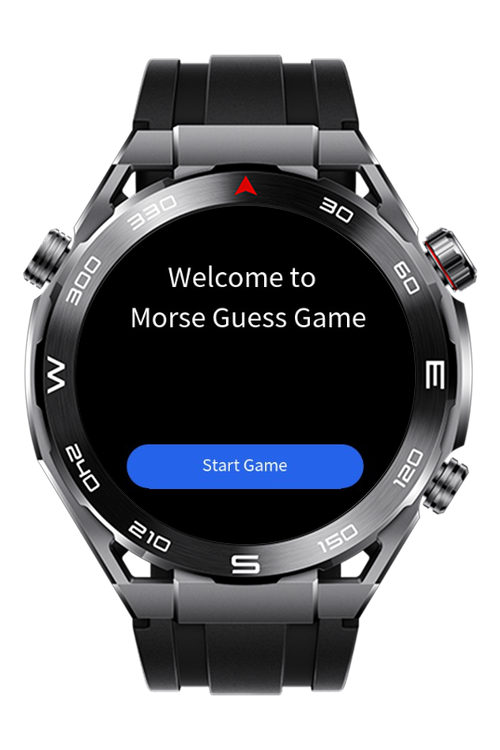
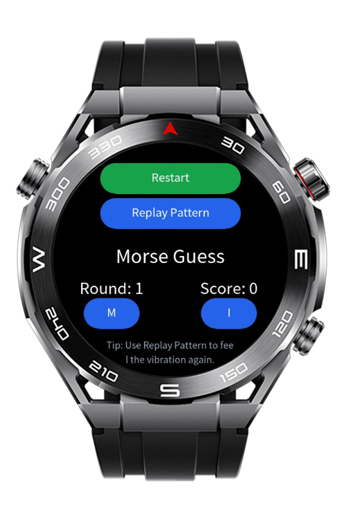
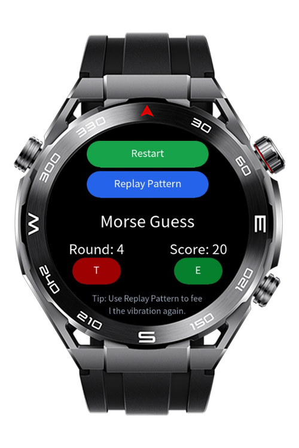
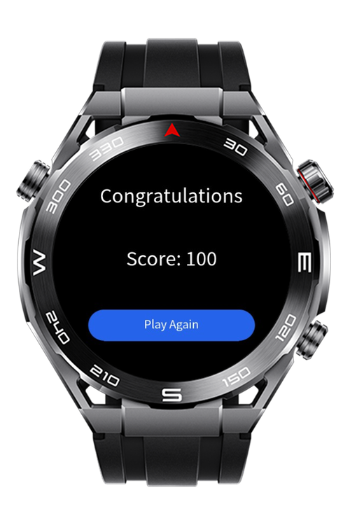

> **Note:** To access all shared projects, get information about environment setup, and view other guides, please visit [Explore-In-HMOS Index](https://github.com/Explore-In-HMOS/hmos-index).

# Morse Guard Lite

**Morse Guard Lite** is a HarmonyOS-based wearable game designed for Huawei smartwatches. Players guess letters
represented by Morse code vibration patterns. Each correct guess increases their score, and reaching 100 points wins the
game. The app uses
haptic feedback, random letter generation, and simple gesture interaction to create an engaging learning experience.

# Preview

<div>
  
  
  
  
</div>

# Use Cases

- **Educational Game**: Learn and practice Morse code through interactive play.
- **Cognitive Training**: Improve reaction time and memory by recognizing vibration patterns.
- **Wearable Interaction Demo**: Showcases the use of haptics and motion sensors on HarmonyOS devices.

# Technology

## Stack

- **Languages**: Javascript
- **Framework**: HarmonyOS Lite SDK 5.0.0 (12)
- **Tools**: DevEco Studio Version 5.1.0.842
- **Libraries**:
    - `@system.vibrator` (vibration patterns)
    - `@ohos.router` (navigation)

## Required Permissions

- `ohos.permission.VIBRATE`

# Directory Structure

```
MorseGuardLite/
├── entry/
│   └── src/
│       └── main/
│           ├── js/
│           │   └── MainAbility/
│           │       ├── app.js                    # Application Lifecycle
│           │       ├── service/
│           │       │   └── haptic_service.js     # Wrapper around vibrator APIs
│           │       │   └── morse_engine.js       # Morse code dictionary and distractor logic
│           │       │   └── pattern_player.js     # Plays Morse patterns as haptic sequences
│           │       └── pages/
│           │           ├── index/                # Landing screen
│           │           │   ├── index.css
│           │           │   ├── index.hml
│           │           │   └── index.js
│           │           ├── game/                 # Main gameplay (Morse vibration, scoring, letter choices)
│           │           │   ├── game.css
│           │           │   ├── game.hml
│           │           │   └── game.js
│           │           ├── win_page/             # Win screen with final score and replay option
│           │           │   ├── win_page.css
│           │           │   ├── win_page.hml
│           │           │   └── win_page.js
│           ├── resources/
│           │   └── base/
│           │       ├── element/
│           │       │   └── string.json           # Resource Strings
│           │       └── media/
│           └── config.json                       # Entry config file
```

# Constraints and Restrictions

## Supported Devices

- Huawei Sport (Lite) Watch GT 4/5/6
- Huawei Sport (Lite) GT4/5 Pro
- Huawei Sport (Lite) Fit 3/4
- Huawei Sport (Lite) D2
- Huawei Sport (Lite) Ultimate

# License

**Morse Guard Lite** is distributed under the terms of the **MIT License**.  
See the [license](/LICENSE) file for more information.